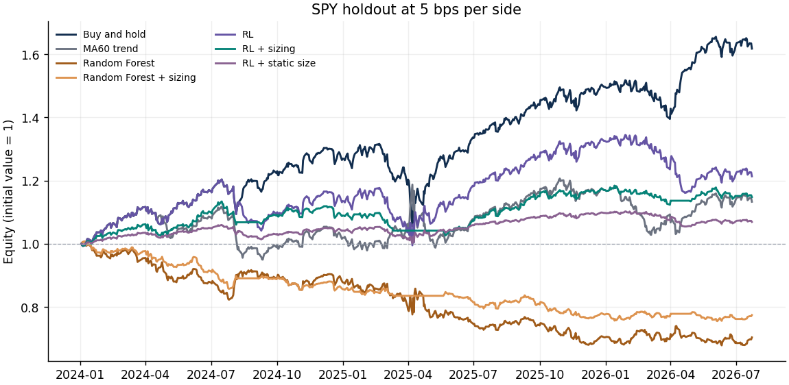
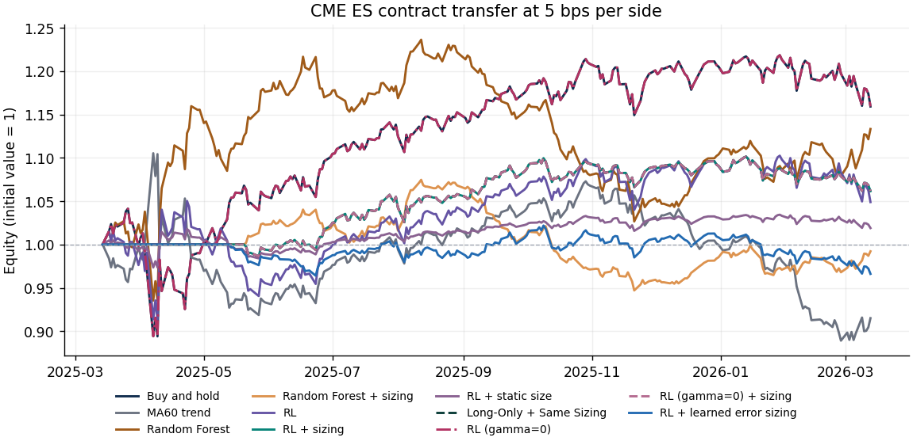

# Uncertainty Aware Reinforcement Learning for Futures Trading

The study trains a tabular trading policy on SPY and evaluates a later SPY holdout and a five-contract CME E-mini S&P 500 (ES) transfer. The second-round comparisons are **post hoc diagnostics on the same two windows**.

**Direction and horizon.** The original gamma=0.9 policy was short on 48 SPY and 31 ES decision sessions, corresponding to six and five entries into a short run. The rolling-volatility rule assigned a zero multiplier on every short session. After sizing, the original policy, fixed long direction and the gamma=0 policy produced identical positions, net returns and turnover on every session. Before sizing, gamma=0 selected long throughout and had a higher net Sharpe and annualized return in both windows.

**Uncertainty beyond volatility.** A learned forecast-error scale improved the descriptive ranking of absolute RF errors and changed sizing on 245 SPY and 75 ES sessions. It increased empirical coverage at similar interval widths, but reduced net Sharpe from 0.771 to 0.314 on SPY and from 0.861 to −0.506 on ES. ES annualized return fell from 6.21% to −3.41%.

**New data.** The [source and sample audit](docs/es-data.md) found no qualifying multi-year ES panel available through the checked public samples. The [new ES holdout protocol](docs/es-holdout-protocol.md) specifies the split, roll policy, costs and primary metrics before any expanded performance is observed.

## Reproduce the experiment

From the repository root with Python 3.12:

```bash
python -m venv .venv
source .venv/bin/activate
python -m pip install -r requirements.txt
python -m unittest discover -s tests -v
OMP_NUM_THREADS=2 OPENBLAS_NUM_THREADS=1 python -m src.experiment --output runs/round2
```

The experiment downloads and verifies six pinned inputs on first run. Network access to the GitHub API and Hugging Face is needed for the initial fetch. For offline reruns, reuse the verified files under `data/raw/` or point `--raw-dir` at a cache. The optional `python -m src.data_download` command warms that cache. Use `--output PATH` to choose where results go. Each run contains separate `spy/` and `es/` outputs with daily forecasts, a full execution ledger, direction audit, paired bootstrap intervals and equity curves. The checked-in snapshot includes the compact matched direction ledger. The manifest records input revisions, digests, date boundaries, quantiles, chosen discount factor and package versions. CSV results use returns and widths in decimal units.

The [research report](Report.docx), [frozen outputs](results/), [run manifest](results/run_manifest.json) and [validation scores](results/rl_validation.csv) reflect the checked-in reference run. The first-round report and outputs are available at commit `c83115e`. Original Day 2–4 CSVs and the processed Parquet remain under `data/processed/` for audit.

## Data and chronology

| Sample | Decision dates | Last exit | Observations |
| --- | --- | --- | ---: |
| SPY training | 1993-04-26 to 2018-12-27 | 2018-12-31 | 6,467 |
| SPY conformal calibration | 2019-01-02 to 2021-12-29 | 2021-12-31 | 755 |
| SPY policy validation | 2022-01-03 to 2023-12-27 | 2023-12-29 | 499 |
| SPY holdout | 2024-01-02 to 2026-07-21 | 2026-07-23 | 639 |
| ES contract transfer | 2025-03-13 to 2026-03-11 | 2026-03-13 | 250 |

- **SPY.** [Yahoo Finance historical bars](https://finance.yahoo.com/quote/SPY/history/) via a [pinned public mirror](https://github.com/Setooooo/etf-insight/tree/25eafd054ddb16d5471761312a0c852a672d6431/data). The mirror's source checksum matches CRLF bytes. The loader verifies the LF-normalized Git blob's own digest. SPY tracks S&P 500 exposure. The study scales the daily open by adjusted close divided by close to approximate total-return open-to-open exposure and uses ratios of adjusted closes for features. A common future adjustment factor cancels in those ratios.
- **ES.** [Pinned public third-party daily contract sample](https://huggingface.co/datasets/lynx1231/historical-futures-data-sample/tree/29efdfa21c5a5b2d7aa306397385cf116e011559/data/daily/CME/ES) for ESH25, ESM25, ESU25, ESZ25 and ESH26. The reference loader checks coverage against fixed weekday exclusions for this window. It uses the provider's date-only bars, with unverified price availability and session conventions. A spot check found a provider close matching settlement and differing from the final sample trade. See the [price and session audit](docs/es-data.md#es-price-and-session-validation) for the timestamped intake path. The chain starts on December 16, 2024, uses the [CME customary roll dates](https://www.cmegroup.com/trading/equity-index/rolldates.html) of March 17, June 16, September 15 and December 15, 2025, and exits before the March 2026 roll. Each holding return uses two opens of the same contract. The close feature chain compounds same-contract ratios, including the incoming contract's ratio on its roll day.
- **Legacy series.** The 3,758-row Parquet lacks a verifiable instrument, source, expiry mapping and roll method. Its volume is missing throughout. The original downloader requested gold (`GC=F`) while preprocessing expected an untracked S&P 500 CSV. The current experiment uses neither the legacy prices nor the legacy labels.

A signal uses information through session `t` close. The trade enters at the next session's open and earns the return through the following session's open. Labels and rewards that would exit across a partition boundary are dropped. Trailing features can use already observed history from prior partitions. Both holdouts use frozen model weights, thresholds and hyperparameters. Dates in the curves mark the open where the interval P&L is realized.

## Models and uncertainty

- **Baselines.** Buy and hold is always long. The MA60 rule takes the sign of close relative to its trailing 60-session moving average. The original 600-tree Random Forest takes the sign of its predicted return. Ridge and a zero forecast are point-forecast comparators.
- **Adaptive intervals.** For each level, compute the finite-sample order statistic at rank `ceil((n + 1) × (1 − alpha))` of calibration absolute residuals divided by trailing 20-session volatility, floored at 1 bp. Multiply by the decision-day scale for the half-width. The original constant absolute-residual interval remains a comparator. The old implementation's constant width came from its formula. It supplied no volatility-regime information, and fitting its sizing quantiles on test data was forward-looking.
- **Position sizing.** The 30th and 70th percentiles of the floored trailing volatility on calibration assign exposure multipliers of 1, 0.5 and 0. Calibration quartiles of RF 90% widths define the forecast diagnostic buckets. Duplicate cutpoints collapse without manufacturing a rank difference for tied inputs. A constant calibration sizing scale yields a constant 0.5 sizing factor. The conformal half-width multiplies volatility by a positive constant in the reference run, so both have the same mathematical ranking. Using volatility directly for sizing avoids a second floating-point comparison at each cut.
- **RL.** State consists of the signs of the 5- and 60-session price-to-average features, the trailing volatility tercile fitted on training data, and previous inventory. Action selects a target of −1, 0 or +1. Reward is one open-to-open net return, including the costs of changing inventory and terminal liquidation. Fitted tabular Q-iteration replays the historical market path, enumerates all inventory/action pairs, estimates the empirical state transitions and iterates Bellman targets to convergence. The previous action becomes the next state's inventory. Validation Sharpe selects the discount factor from 0.50, 0.90 and 0.97, with ties going to the first candidate. The reference run selected 0.90. The matched gamma=0 diagnostic uses the same immediate reward and inventory state with zero weight on continuation. It is evaluated with and without the original sizing overlay.
- **Ablation.** Plain RL, adaptive sizing and constant sizing share the same greedy action sequence. Only the executed position changes. The constant multiplier matches the adaptive policy's average absolute exposure on validation (0.309), so realized test exposures can differ. The sized policy remains an execution overlay on the frozen RL policy. Long-Only + Same Sizing takes the identical multiplier on every session. Policy replay uses prior raw action as inventory for both discount factors. The simulator charges the actual fractional changes after sizing.

## Performance at 5 bps per side

| Strategy | SPY annualized | SPY Sharpe | SPY max DD | ES annualized | ES Sharpe | ES max DD |
| --- | ---: | ---: | ---: | ---: | ---: | ---: |
| Buy and hold | 20.88% | 1.253 | −19.77% | 16.05% | 0.855 | −14.14% |
| MA60 trend | 5.05% | 0.385 | −16.81% | −8.56% | −0.355 | −19.56% |
| Random Forest | −12.94% | −0.770 | −32.61% | 13.44% | 0.739 | −16.95% |
| Random Forest + sizing | −9.60% | −1.313 | −25.00% | −0.79% | −0.071 | −11.87% |
| RL | 7.93% | 0.551 | −17.32% | 4.94% | 0.342 | −10.44% |
| RL + sizing | 5.59% | 0.771 | −9.51% | 6.21% | 0.861 | −3.61% |
| RL + static size | 2.67% | 0.551 | −5.47% | 1.91% | 0.342 | −3.32% |
| Long-Only + Same Sizing | 5.59% | 0.771 | −9.51% | 6.21% | 0.861 | −3.61% |
| RL (gamma=0) | 20.88% | 1.253 | −19.77% | 16.05% | 0.855 | −14.14% |
| RL (gamma=0) + sizing | 5.59% | 0.771 | −9.51% | 6.21% | 0.861 | −3.61% |
| RL + learned error sizing | 1.98% | 0.314 | −7.87% | −3.41% | −0.506 | −5.45% |

- [SPY performance](results/spy/performance_summary.csv) · [Ablation](results/spy/ablation.csv) · [Cost sensitivity](results/spy/cost_sensitivity.csv) · [Forecasts summary](results/spy/forecast_summary.csv) · [Uncertainty buckets](results/spy/uncertainty_buckets.csv)
- [ES performance](results/es/performance_summary.csv) · [Ablation](results/es/ablation.csv) · [Cost sensitivity](results/es/cost_sensitivity.csv) · [Forecasts summary](results/es/forecast_summary.csv) · [Uncertainty buckets](results/es/uncertainty_buckets.csv)

| Post hoc detail | SPY | ES |
| --- | --- | --- |
| Matched daily position, net return and turnover | [Daily audit](results/spy/direction_daily.csv) · [Counts](results/spy/direction_summary.csv) | [Daily audit](results/es/direction_daily.csv) · [Counts](results/es/direction_summary.csv) |
| Error-scale ranking and net results | [Rank diagnostics](results/spy/scale_comparison.csv) · [Coverage and performance](results/spy/scale_performance.csv) | [Rank diagnostics](results/es/scale_comparison.csv) · [Coverage and performance](results/es/scale_performance.csv) |
| Paired changes in return and Sharpe | [Bootstrap intervals](results/spy/paired_intervals.csv) | [Bootstrap intervals](results/es/paired_intervals.csv) |





Turnover approximates traded notional as a fraction of equity using changes in target exposures, summed across sessions. Mark-to-market weight drift between rebalances is omitted. A flip from −1 to +1 costs two units. On a roll, turnover is the sum of absolute old and new exposure. Both initial entry and final liquidation are charged. Net simple returns compound from 1. Annualized return is ending equity raised to `252 / N` minus 1. Sharpe is `sqrt(252) × mean(daily net return) / sample_std(daily net return)` at a zero risk-free rate. A zero-variance Sharpe is blank. Drawdown includes the initial equity peak. Cost sensitivity reapplies 0 and 10 bps to the frozen positions alongside the reference case.

The simulator uses normalized fractional notional and stylized open fills. ES is modeled using percentage changes in contract price, equivalent to a fractional position in a fully collateralized contract before costs. Exchange margin, integer contract sizing, variable slippage, market impact, collateral yield, and ETF financing and borrow fees are outside the model. Empirical conformal coverage can change under temporal dependence and market shifts. The high uncertainty bucket had larger average absolute realized returns than the low bucket in both samples, but SPY and ES share a market and overlapping dates. Interpret these results as descriptive comparisons over the two historical samples.

## Error scale and paired comparisons

The volatility benchmark computes the sizing tiers directly from trailing 20-session volatility with a 1 bp floor. The learned scale uses a fixed gradient-boosted regressor on the same trailing features. Its labels are absolute RF prediction errors from four expanding chronological folds spanning 2003–2018. Each RF fold is fitted strictly on earlier completed labels, and all 4,019 scale labels exit inside their fold. The full-training RF provides the common forecast center. The 2019–2021 calibration partition sets both the learned 90% residual quantile and each method's 30th and 70th sizing percentiles. Both risk methods apply the same 1, 0.5 and 0 multipliers to the original gamma=0.9 action sequence.

| Sample and scale | 90% coverage | Mean width | Abs. error rank correlation | Avg. exposure | Turnover |
| --- | ---: | ---: | ---: | ---: | ---: |
| SPY rolling volatility | 91.08% | 3.22% | 0.203 | 56.73% | 24 |
| SPY learned error scale | 91.71% | 3.16% | 0.270 | 53.68% | 88 |
| ES rolling volatility | 90.80% | 3.56% | 0.270 | 56.00% | 9 |
| ES learned error scale | 92.40% | 3.54% | 0.448 | 50.20% | 35 |

The learned scale's risk ranks correlated 0.660 with volatility ranks in SPY and 0.757 in ES (Spearman). Its sized policy had less drawdown on SPY and more on ES. Its realized positions can differ in direction because some original short decisions receive positive learned multipliers. Average exposure also differs, so the net contrast evaluates each complete overlay. It does not isolate a return difference at equal realized exposure.

The paired circular block bootstrap uses 2,000 draws of 10-session blocks (seed 42), sampling both net return series at the same dates. Learned minus volatility Sharpe was −0.458 on SPY (95% interval [−1.182, 0.201]) and −1.367 on ES ([−2.029, −0.751]). The unsized horizon contrasts had intervals spanning zero in both samples. These intervals condition on the fitted policies, observed paths, cost model and block length. They describe previously seen, overlapping windows and omit model-estimation uncertainty.
